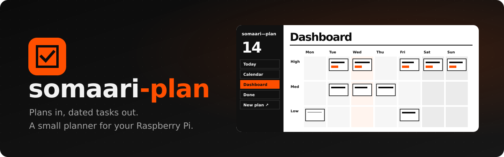
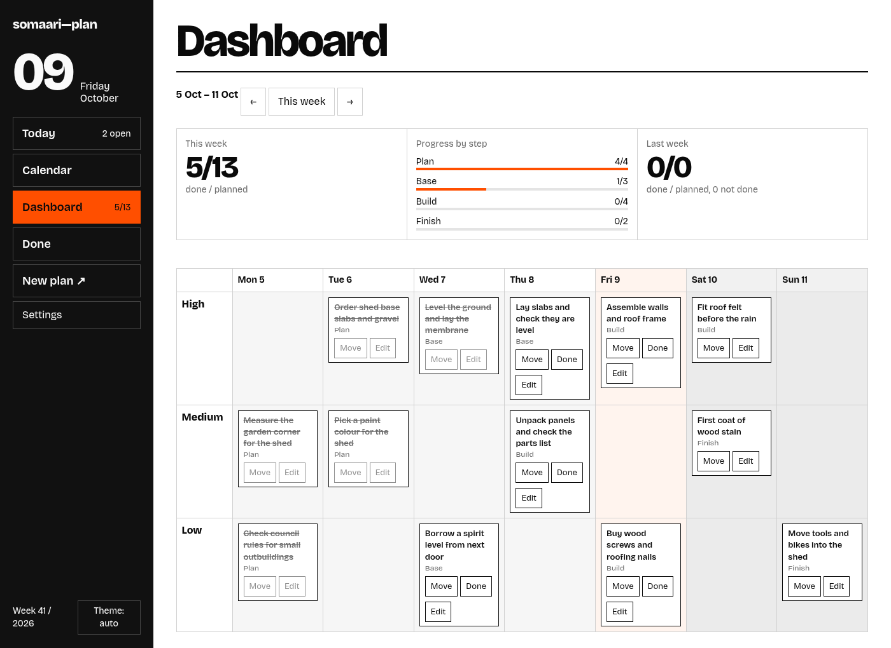
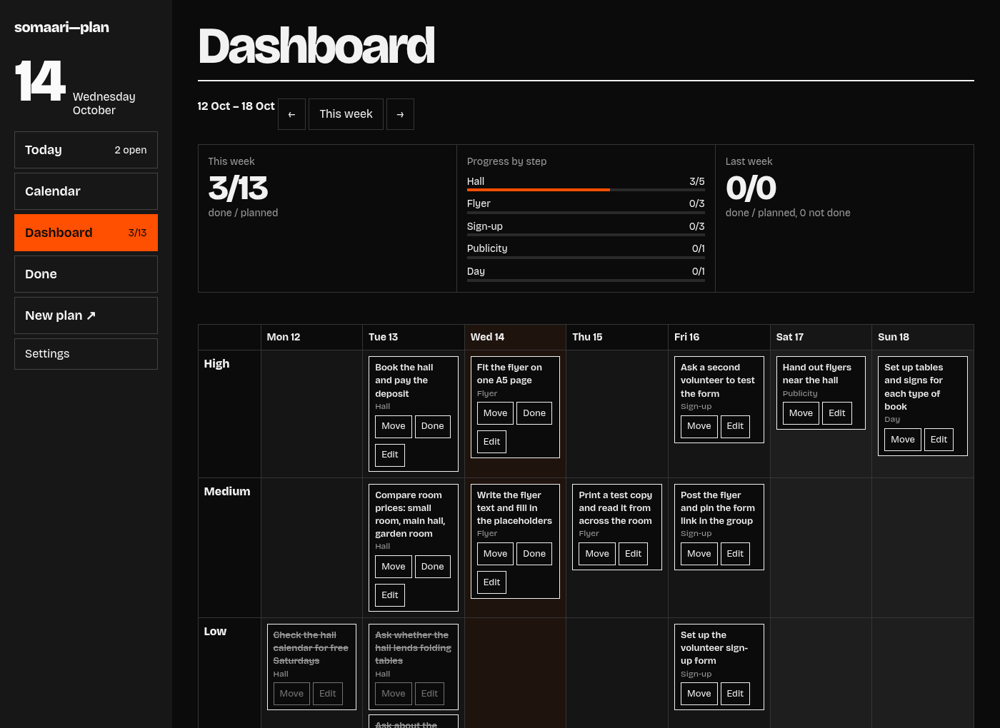
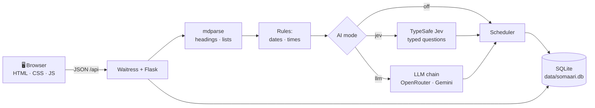

<div align="center">



<br>

**Drop in a plan, get a week of dated tasks.**<br>
Upload a Markdown plan, paste loose text, or type a quick line, and somaari-plan turns it into
dated tasks you can see by day, week and priority. One person, one Raspberry Pi, your home network.

<br>

[](https://www.python.org/)
[](https://flask.palletsprojects.com/)
[](https://www.sqlite.org/)
[](#%EF%B8%8F-development)
[](docs/GUIDE.md#ai)
[](https://www.raspberrypi.com/products/raspberry-pi-5/)
[](LICENSE)

[Features](#-features) ·
[Install](#-install) ·
[Usage](#-usage) ·
[How it works](#-how-it-works) ·
[Privacy](#-privacy) ·
[Security](#%EF%B8%8F-security-model) ·
[Development](#%EF%B8%8F-development) ·
[Guide](docs/GUIDE.md)

</div>

| Light | Dark |
|---|---|
|  |  |

> [!WARNING]
> There's no login: anyone who can reach the port can read and change your tasks. Keep it on your
> home network or a private one (ZeroTier, Tailscale, WireGuard) and **never port-forward it to
> the internet.** See [Who can reach it](docs/GUIDE.md#who-can-reach-it).

---

## ✨ Features

- 📝 **Plans in**: upload `.md` plans or paste text. `## Headings` become steps, list items become
  tasks, and dates in the text ("Thu 15 Oct", "friday", "4pm") are read by rules, not guessed.
- 👀 **Review before saving**: an editable preview (title, step, priority, date), flagged tasks to
  check, and skipped lines you can restore with one click.
- ⚡ **Quick add**: type `call the plumber friday at 5pm` and get a task card to check and add.
- 📅 **Today, Calendar, Dashboard, Done**: today's list by priority; day, week and month views; a
  7-day board by priority (drag, or tap to move); finished tasks to search and reopen.
- ✏️ **Edit in place**: title, step, priority, date and time, right in the list or on the board.
- 🤖 **AI optional**: [TypeSafe](https://typesafe.ai) Jev answers small typed questions, a free LLM
  only rewrites loose prose, and `mode = "off"` works with no AI at all. Answers are cached.
- 💾 **Backups**: JSON export and add-only import from Settings.
- 🌗 **Light and dark**, keyboard friendly, works at phone width.
- 🪶 **Light on the Pi**: Flask + Waitress + SQLite, plain HTML/CSS/JS, idle under 80 MB of RAM.

## 🚀 Install

You need a Raspberry Pi (or any Linux machine) with Python 3.11+, git and [uv](https://docs.astral.sh/uv/):

```sh
git clone https://github.com/ashwinkrpi/somaari-plan.git && cd somaari-plan
uv sync
cp config.example.toml config.toml && cp .env.example .env && chmod 600 .env
uv run somaari-plan           # then open http://<pi-address>:8710
```

The [guide](docs/GUIDE.md) covers the rest:
- [Who can reach it](docs/GUIDE.md#who-can-reach-it), [run as a service](docs/GUIDE.md#run-as-a-service)
  (systemd), [updating](docs/GUIDE.md#updating) and [demo data](docs/GUIDE.md#try-it-with-demo-data)
- [Server](docs/GUIDE.md#server): host, port and where each setting can come from
- [AI](docs/GUIDE.md#ai): modes, providers and keys, or no AI at all
- [Backups](docs/GUIDE.md#backups) and [logs](docs/GUIDE.md#logs)

## 🧑‍💻 Usage

| Do this… | What happens |
|---|---|
| **New plan ↗** → upload a `.md` or paste text → **Generate plan →** | A preview of dated tasks to edit, then **Add N tasks to plan** |
| Type a line in **Quick add** | A task card with the date and time read from it |
| **Today** → **Mark done** | The task is closed, with the time it was closed |
| **Edit** on any task | Change title, step, priority, date or time in place |
| **Calendar** → Day / Week / Month | Tasks by date; weekends shaded |
| **Dashboard** → drag a card (or **Move** → **Move here**) | Reschedules it to that day and priority |
| **Done** → search → **Reopen** | Brings a finished task back |
| **Settings** | AI mode and providers, date format, thresholds, backups |

Everything else, with screenshots: [Using the app](docs/GUIDE.md#-using-the-app).

## 🧠 How it works



<details>
<summary><b>Step by step</b></summary>

<br>

One Python process (Waitress serving Flask), one SQLite file, no background workers.
1. **Parse in code:** `mdparse` drops code blocks, tables and paragraphs, turns `## headings` into
   steps and list items into candidate tasks; nested items become notes.
2. **Dates by rules:** each line is read for dates and times ("14 Oct", "friday", "4pm",
   "3rd of next month"); undated lines take the date of the line above.
3. **AI answers typed questions only:** in `jev` mode, Jev scores each line (is it a task? which
   priority? a meeting? which date parts, when the rules found none). Code applies the
   thresholds. Jev never writes text; an LLM only rewrites loose prose into titles, or does the
   whole extraction in `llm` mode. Answers are cached by content, so repeats cost nothing.
4. **Schedule in code:** dates from the text, a week (High tasks early, a per-day limit), or one
   day.
5. **Review, then commit:** nothing is saved until you add the preview's tasks.

The browser fetches JSON from `/api/…` and renders everything itself; there's no frontend build.
Routes and modules: [docs/ARCHITECTURE.md](docs/ARCHITECTURE.md).

</details>

## 🔒 Privacy

> [!IMPORTANT]
> **TL;DR:** your tasks stay in one SQLite file on your Pi. With AI off, nothing leaves it. With
> AI on, only the lines being decided go to the provider you chose; there's no analytics or
> telemetry.

<details>
<summary><b>What leaves your Pi, and what doesn't</b></summary>

<br>

- **Tasks** are stored only in `data/somaari.db`. Back it up with Export or a nightly copy
  ([Backups](docs/GUIDE.md#backups)).
- **Jev** (`mode = "jev"`) receives the plan's candidate lines, their steps and today's date.
- **LLM providers** receive only the prose sentences to rewrite (`rewrite_prose`), or the plan
  text in `mode = "llm"`. Free tiers such as OpenRouter's may log prompts upstream.
- **Quick add** uses rules first and asks Jev only for a date the rules miss; never an LLM.
- **The page** loads nothing from the internet: the font is bundled, there's no CDN.
- **Logs** (`data/ai.log`) record provider, model, token count and time, never content or keys.

</details>

## 🛡️ Security model

| Layer | Protection |
|---|---|
| 🌐 **Network** | Meant for a home LAN or a private network. No login, so access to the port is access to your tasks |
| 🔑 **Keys** | Only in `.env` (gitignored, `chmod 600`). Never shown in the app, sent to the browser or logged |
| 📥 **Uploads** | 24 MB request limit; files are parsed as text, never run |
| 💾 **Import** | Add-only: a backup can add tasks but never change or delete existing ones |

Bind to `127.0.0.1` to keep it on the Pi itself, or to a single VPN address; see
[Who can reach it](docs/GUIDE.md#who-can-reach-it).

## 🛠️ Development

```sh
uv run somaari-plan --dev          # Flask debug server with reload
uv run pytest -q                   # tests use mocks; no real AI calls
uv run python -m app.ai.smoke jev  # one real call to check a provider (needs a key)
```

Design and build docs are in [docs/](docs/): architecture, data model, AI providers and prompts,
UI spec. Screenshots in `docs/screenshots/` come from neutral demo data only.

## Licence

MIT, see [LICENSE](LICENSE). The bundled Bricolage Grotesque font is under the SIL Open Font License ([web/fonts/OFL.txt](web/fonts/OFL.txt)).

<div align="center">
<br>
<sub>Made for a Raspberry Pi 5 and a week that needs a plan.</sub>
</div>
