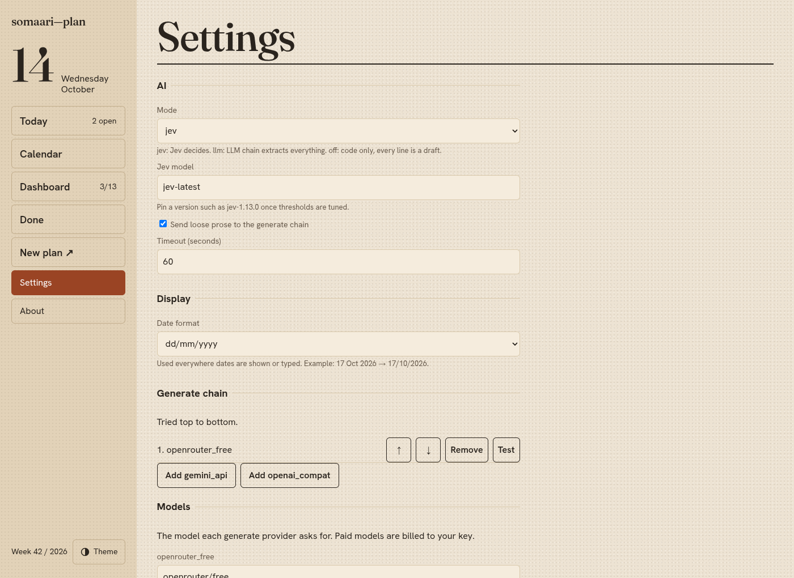
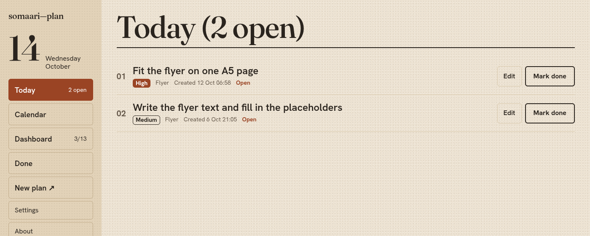
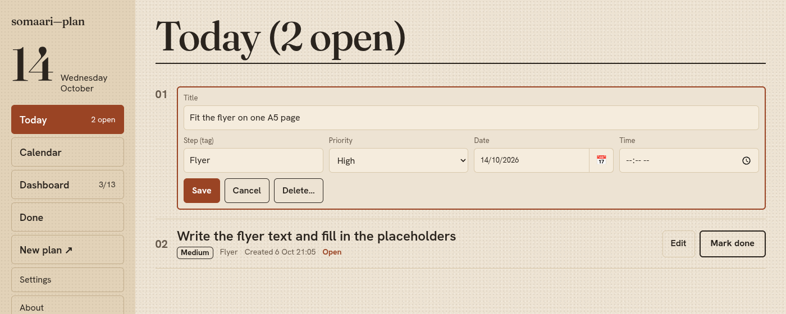
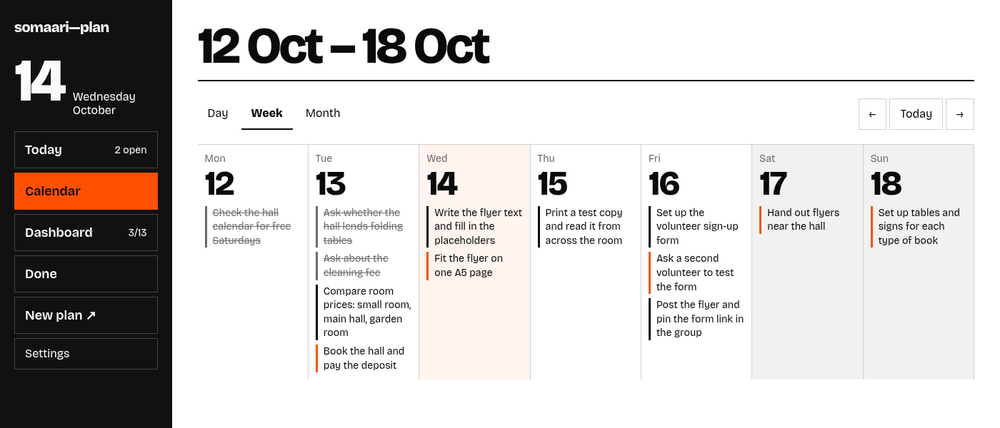
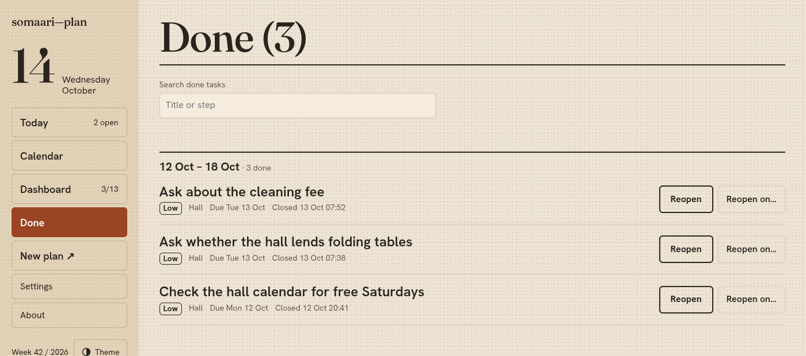
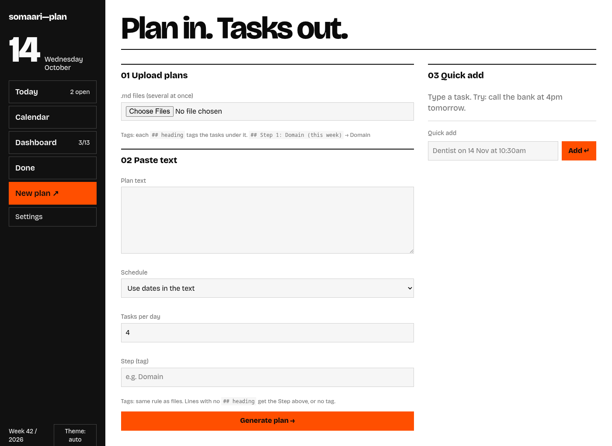
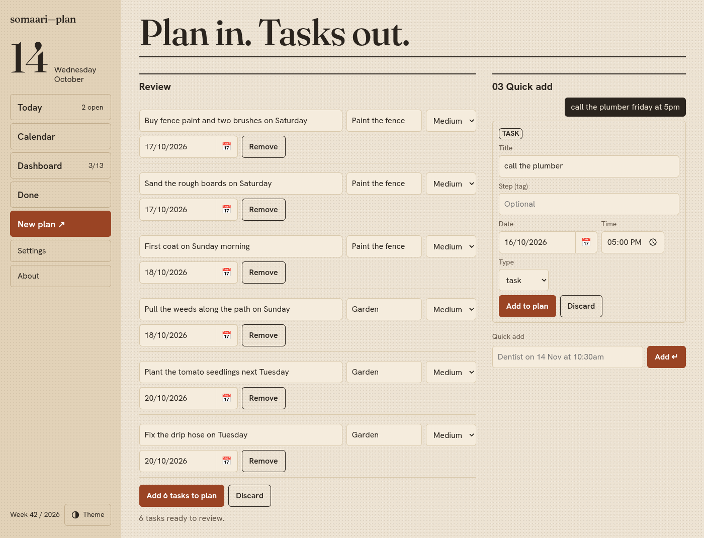
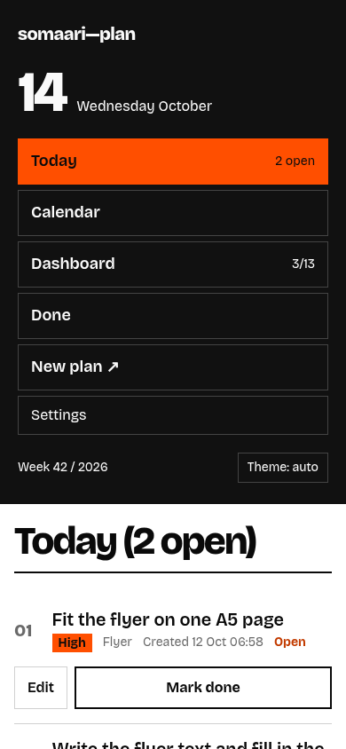
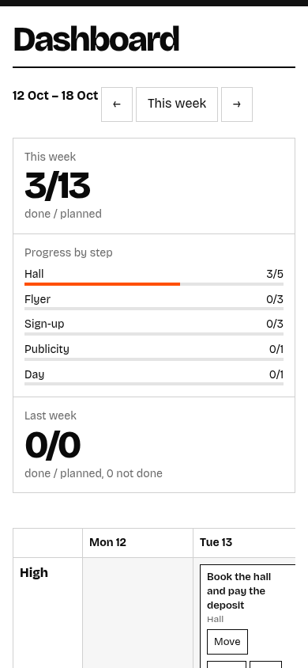

<div align="center">


<br>

**The somaari-plan guide: install it on your Pi, set up the AI (or don't), and plan your week.**<br>
For how it works inside, privacy, the API and development, see the [README](../README.md).

<br>

[Installation](#-installation) ·
[Configuration](#%EF%B8%8F-configuration) ·
[Using the app](#-using-the-app) ·
[Troubleshooting](#-troubleshooting) ·
[README](../README.md)

</div>


> [!NOTE]
> All screenshots use neutral demo data (a book swap plan and a garden plan), not real tasks.

<details>
<summary><b>Contents</b></summary>

<br>

- 🚀 [Installation](#-installation): [Requirements](#requirements) ·
  [Install on a Raspberry Pi](#install-on-a-raspberry-pi) · [Who can reach it](#who-can-reach-it) ·
  [Run as a service](#run-as-a-service) · [Updating](#updating) ·
  [Try it with demo data](#try-it-with-demo-data)
- ⚙️ [Configuration](#%EF%B8%8F-configuration): [Files](#files) · [Server](#server) ·
  [AI](#ai) · [The Settings page](#the-settings-page) · [Backups](#backups) · [Logs](#logs)
- 🧭 [Using the app](#-using-the-app): [The screen](#the-screen) · [Today](#today) ·
  [Editing a task](#editing-a-task) · [Calendar](#calendar) · [Dashboard](#dashboard) ·
  [Done](#done) · [New plan](#new-plan) · [How dates are read](#how-dates-are-read) ·
  [Quick add](#quick-add) · [On a phone](#on-a-phone)
- 🩺 [Troubleshooting](#-troubleshooting)

</details>

---

## 🚀 Installation

### Requirements

| You need | Why |
|---|---|
| 🖥️ A Linux machine that stays on | A **Raspberry Pi 5** (or any Pi with a 64-bit OS, or any Linux box). Idle under 80 MB of RAM |
| 🐍 **Python 3.11+**, **git** and **[uv](https://docs.astral.sh/uv/)** | Raspberry Pi OS Bookworm ships Python and git. uv sets up the app's Python packages: Flask, Waitress and somaari-common (shared About info, from GitHub), at the versions pinned in `uv.lock` |
| 🔑 Optional: a **TypeSafe API key** | For the default AI mode. Without one, use an LLM key or no AI at all; see [AI](#ai) |

No Docker, no Node, no build step: the frontend is plain HTML, CSS and JavaScript.

### Install on a Raspberry Pi

```sh
curl -LsSf https://astral.sh/uv/install.sh | sh   # once per machine; installs uv to ~/.local/bin
source $HOME/.local/bin/env                       # or open a new terminal, so this shell finds uv
git clone https://github.com/ashwinkrpi/somaari-plan.git
cd somaari-plan
uv sync                                           # creates .venv and installs the pinned packages
cp config.example.toml config.toml
cp .env.example .env && chmod 600 .env
uv run somaari-plan
```

`uv run somaari-plan` is the same as `.venv/bin/somaari-plan` (which the service uses) and
`.venv/bin/python -m app`.

It prints `somaari-plan on http://0.0.0.0:8710`. Open **`http://<pi-address>:8710`** from any
device on your network. Stop it with **Ctrl+C**; to keep it running, see
[Run as a service](#run-as-a-service).

Your tasks live in `data/somaari.db` (SQLite), created on first start.

### Who can reach it

`host` under `[server]` in `config.toml` decides which network addresses the app listens on:

| `host` | Reachable from |
|---|---|
| `"0.0.0.0"` (default) | 🏠 every network the Pi is on: your home LAN, and ZeroTier/Tailscale if installed |
| `"127.0.0.1"` | 🔒 the Pi itself only |
| one IP, e.g. the ZeroTier IP | 🔗 only that network |

> [!WARNING]
> There is **no login**: anyone who can reach the port can read and change your tasks. Keep it on
> a home network you trust, use ZeroTier, Tailscale or WireGuard for access away from home, and
> **never port-forward it to the internet.**

### Run as a service

To start it at boot and restart it if it crashes, create a systemd user service in
`~/.config/systemd/user/somaari-plan.service`:

```ini
[Unit]
Description=somaari-plan

[Service]
WorkingDirectory=%h/somaari-plan
EnvironmentFile=%h/somaari-plan/.env
ExecStart=%h/somaari-plan/.venv/bin/somaari-plan
Restart=on-failure

[Install]
WantedBy=default.target
```

```sh
systemctl --user daemon-reload
systemctl --user enable --now somaari-plan
loginctl enable-linger "$USER"   # keep it running after logout and start it at boot
```

Adjust the paths if you cloned somewhere other than `~/somaari-plan`. Check on it with
`systemctl --user status somaari-plan`; restart it after changing `config.toml` or `.env` with
`systemctl --user restart somaari-plan`.

> [!TIP]
> Using the `gemini_cli` provider? The service doesn't see your shell's `PATH`. Add
> `Environment=PATH=…` with the folder that holds `gemini` to the `[Service]` section, and log in
> to the Gemini CLI as the same user.

### Updating

```sh
cd ~/somaari-plan
git pull
uv sync                                  # installs any package changes from uv.lock
uv run python -m app.stamp               # optional: About shows this commit instead of "dev"
systemctl --user restart somaari-plan    # or stop and start somaari-plan
```

Your `config.toml`, `.env` and `data/` are not tracked by git, so they're kept. New options appear
in `config.example.toml`; copy any you want into `config.toml`.

### Try it with demo data

```sh
.venv/bin/python -m app.seed
```

Adds 13 demo tasks (a book swap plan for the week of 5 October 2026), only if the database is
still empty. Open **Calendar** or **Dashboard** and go to that week to see them. To start clean
afterwards, stop the app and delete `data/somaari.db`.

---

## ⚙️ Configuration

### Files

| File | What's in it | In git? |
|---|---|---|
| `config.toml` | Server, AI and display settings (copy of `config.example.toml`) | No |
| `.env` | API keys, and optionally host/port. Keep it `chmod 600` | No |
| `data/somaari.db` | Your tasks (SQLite) | No |
| `data/ai.log` | One line per AI call: provider, model, tokens, time | No |

`config.toml` can live elsewhere: set `SOMAARI_CONFIG=/path/to/config.toml`.

### Server

```toml
[server]
host = "0.0.0.0"    # LAN; "127.0.0.1" = this Pi only
port = 8710
threads = 4
```

| Setting | Default | Also settable with |
|---|---|---|
| `host` | `0.0.0.0` | `SOMAARI_HOST` in `.env`, or `--host` |
| `port` | `8710` (1024 to 65535) | `SOMAARI_PORT` in `.env`, or `--port` |
| `threads` | `4` | — |

Command-line flags win over `.env`, which wins over `config.toml`. If the port is taken, the app
stops with a message naming the port; it never picks another one by itself. Check a port first
with `ss -ltn | grep :8711`. Host and port changes need a restart.

### AI

The app reads plans with code first: headings, list items, dates, times and scheduling never need
AI. AI only answers small questions code can't (is this line really a task? what priority? is it
a meeting?) and, optionally, rewrites loose prose into task titles.

Keys go in `.env` only; they're never shown in the app or written to logs:

```sh
TYPESAFE_API_KEY=…      # for mode = "jev"
OPENROUTER_API_KEY=…    # for the openrouter_free provider
GEMINI_API_KEY=…        # for the gemini_api provider
```

Then pick a mode under `[ai]` in `config.toml` (or on the [Settings page](#the-settings-page)):

| `mode` | Needs | What happens |
|---|---|---|
| `jev` (default) | `TYPESAFE_API_KEY` | [TypeSafe](https://typesafe.ai) Jev answers typed questions about each line. An LLM from `generate_chain` only rewrites loose prose into titles, if `rewrite_prose = true` |
| `llm` | a key for a provider in `generate_chain` | For people without a TypeSafe key: the LLM does the whole extraction |
| `off` | nothing | Code only: every list item becomes a draft task for you to review |

`generate_chain` is a list of LLM providers, tried in order:

| Provider | Key | Notes |
|---|---|---|
| `openrouter_free` | `OPENROUTER_API_KEY` | Free and rate-limited. Upstream may log prompts, so only the prose sentences are sent |
| `gemini_api` | `GEMINI_API_KEY` | Free tier available |
| `gemini_cli` | none (CLI login) | Needs the `gemini` CLI installed and logged in for the same user |

Set `generate_chain = []` to never call an LLM.

> [!IMPORTANT]
> **Subscription vs API:** a chat subscription (Gemini app, ChatGPT, Claude) does not include API
> access. A Gemini subscription works here only through `gemini_cli`; everything else needs an API
> key.

- **When the AI fails** (bad key, no network, rate limit), `jev` falls back to `llm` if a chain is
  set, else to `off`, and the preview tells you to check dates and priorities.
- **Answers are cached**, so uploading the same plan again makes no AI calls.
- **Check a provider** from the Pi: `.venv/bin/python -m app.ai.smoke jev` (or `openrouter_free`,
  `gemini_api`, `gemini_cli`). It prints the model, input tokens and time taken.

<details>
<summary><b>All <code>[ai]</code> and <code>[ui]</code> settings</b></summary>

<br>

```toml
[ai]
mode = "jev"                           # jev | llm | off
jev_model = "jev-latest"               # or pin a version, e.g. "jev-1.13.0"
generate_chain = ["openrouter_free"]   # [] disables all LLM use
rewrite_prose = true                   # send prose-heavy blocks to generate_chain
timeout_s = 60

[ai.thresholds]
task_accept = 0.7                      # at or above: the line is a task
task_review = 0.4                      # between review and accept: a task, flagged for review
confidence_review = 0.6                # priority or date confidence below this: flagged

[ui]
date_format = "dd/mm/yyyy"             # dd/mm/yyyy | mm/dd/yyyy | yyyy-mm-dd
```

Lines scoring below `task_review` go to the preview's **skipped lines**, one click from being
restored. `date_format` is how dates are shown and typed everywhere; they're stored as ISO dates
either way.

</details>

### The Settings page



**Settings** (bottom of the menu) edits everything in `[ai]` and `[ui]`: mode, Jev model, prose
rewriting, timeout, date format, the generate chain (add, reorder, remove, and **Test** each
provider) and the thresholds. **Save settings** writes `config.toml`. It never shows or edits keys,
and shows host and port read-only.

> [!NOTE]
> Saving from the Settings page rewrites `config.toml` without its comments.

### About

**About** (last in the menu) shows the app version and build, developer contacts, and debug info
(OS, device, Python, key packages, data/config/log folders, AI provider and model *names*).
**Copy debug info** copies it as plain text to paste into a bug report. It never includes keys.
Build shows `dev` / `unknown` unless you ran `.venv/bin/python -m app.stamp` (see Updating).

### Backups

- **From the app:** Settings → **Backup** → **Export backup** downloads every task as JSON.
  **Import backup** adds tasks from such a file. Import only adds: tasks already there (same title,
  due date and creation time) are skipped, and nothing is changed or deleted.
- **Nightly copy of the database:** install the SQLite CLI (`sudo apt install sqlite3`) and add a
  cron job (`crontab -e`) like:

  ```sh
  0 2 * * * cd ~/somaari-plan && mkdir -p data/backups && sqlite3 data/somaari.db ".backup data/backups/$(date +\%F).db" && find data/backups -name '*.db' -mtime +14 -delete
  ```

  That keeps two weeks of daily copies. Copy `data/backups/` off the Pi too.

### Logs

- **App log:** journald, when run as a service: `journalctl --user -u somaari-plan`.
- **AI log:** `data/ai.log`, one short line per call (provider, model, input tokens, time); never
  the content of your plans or your keys. It isn't rotated, but grows slowly; delete it any time.

---

## 🧭 Using the app

### The screen

| Part | What's there |
|---|---|
| **Menu** (left) | Today's date, **Today** (with the number of open tasks), **Calendar**, **Dashboard** (done / planned this week), **Done**, **New plan ↗** and **Settings** |
| **Footer** | The week number, and the **Theme** button: auto (follows your device), light or dark. Remembered in this browser |
| **Page** | One page at a time |

Every task has a title, a **priority** (High, Medium, Low), an optional **step** (a tag such as
"Garden"), a due date and an optional time. Each task records when it was created and closed.

### Today



Today's tasks, highest priority first. Each row shows the priority, step, when it was created and
whether it's open or when it was closed. **Mark done** closes a task (struck through); press it
again (**Done ✓**) to reopen it.

### Editing a task



**Edit** (on Today, the Calendar's Day view and Dashboard cards) opens the task in place: title,
step, priority, date and time. **Save**, or **Cancel** / **Esc**. **Delete…** asks first; it's for
mistakes, finished work should be marked done instead. Done tasks can't be edited until you
reopen them.

### Calendar



- **Week:** seven columns, with a coloured edge per task: orange for High, black for others, grey
  (struck through) for done. Weekends are shaded.
- **Month:** a Monday-first grid with the number of tasks per day; today is filled orange.
- **Day:** a numbered list with created and closed times, and **Edit**.

← and → move by a day, week or month; **Today** jumps back.

### Dashboard

A summary of the week, then a board of the next seven days by priority (see the screenshot at the
top).

- **This week:** done / planned. **Progress by step:** a bar per step. **Last week:** done /
  planned, how many were moved to another week, and how many were left undone.
- **Move a task:** drag a card to another day or priority. Or, without a mouse, press **Move**,
  then **Move here** in the cell you want; **Cancel** stops.
- Open cards due today or earlier have a **Done** button. Done cards are struck through and can't
  be moved.
- ← / **This week** / → change the week.

### Done



Finished tasks, newest first, grouped by the week they were closed. Search by title or step.
**Reopen** puts a task back (a past due date moves to today); **Reopen on…** lets you pick the day.
The page shows the latest 500; search finds older ones.

### New plan



Three ways in, all on one page:

**01 Upload plans.** One or more Markdown (`.md`) files. Per file, choose **Schedule**:
**Dates inside the file** (use the dates written in it) or **Week starting** a date you pick.

**02 Paste text.** Notes, a list, an email. **Schedule**: **Use dates in the text**, **Week
starting**, or **A single day**; **Tasks per day** limits how many land on one day; **Step (tag)**
tags pasted lines that have no heading.

Then **Generate plan →**. Nothing is saved yet: you get a preview to review.



- Every task is editable: title, step, priority, date. **Remove** drops one.
- Tasks the app is unsure about are **flagged** with the reason; check them.
- **N skipped lines** (collapsed) lists what wasn't taken as a task; one click restores a line.
- **Add N tasks to plan** saves them; **Discard** throws the preview away.

<details>
<summary><b>What counts as a task in a Markdown file</b></summary>

<br>

- **Tasks:** top-level list items (`-`, `*`, `1.`) and open checkboxes (`- [ ]`). Ticked boxes
  (`- [x]`) are skipped as already done.
- **Indented items** are details of the item above, added to its notes, not separate tasks.
- **`## Headings`** become the step for the tasks under them. `## Step 1: Domain (this week)` →
  "Domain": `Step N:`, `Later:` and anything in brackets are dropped, max 30 characters. The `#`
  title and `###` subheadings don't change the step.
- **Ignored:** paragraphs, code blocks, tables, HTML comments, link-only lines.
- A `##` section with no list items at all becomes one task, from its heading.
- **Pasted text** without list items: each sentence becomes a candidate task.

</details>

### How dates are read

Dates are read by rules in code first, in each line (text in brackets is ignored):

| Written | Means |
|---|---|
| `today`, `tomorrow`, `tonight` | That day |
| `friday`, `next Tuesday` | The next one (today counts) |
| `14 Oct`, `Thu 15 Oct`, `3rd of next month` | That date; no year means this year, or next year if it's long past |
| `next week` | Monday of next week (shown as "week of") |
| `4pm`, `10:30am`, `6:00am` | That time |
| `morning`, `afternoon`, `evening` | 10:00, 15:00, 18:00 |

- With **Dates inside the file / Use dates in the text**, a line without a date takes the date of
  the nearest dated line above it. Lines before the first date are spread over the week from today.
- With **Week starting**, tasks fill Monday to Sunday in order, up to **Tasks per day**, with High
  tasks no later than Wednesday when there's room; extras go to the next Monday.
- With **A single day**, everything lands on that day.
- Only when the rules find nothing but a line clearly names a date does Jev get asked.

### Quick add

Type one line in **03 Quick add**, e.g. `call the plumber friday at 5pm` or
`Dentist on 14 Nov at 10:30am`, and press **Enter** (or **Add ↵**). You get a card with the title,
date, time, type (task or meeting) and an optional step; fix anything, then **Add to plan**, or
**Discard**. **Clear N** discards all pending cards. Added cards drop off when you leave the page;
the task is on Today and the Calendar. Quick add never uses an LLM.

### On a phone

<div align="center">

&nbsp;&nbsp;

</div>

Below 900 px the menu stacks on top of the page. Wide views (the board, the week) scroll sideways
on their own. Everything works by touch: **Move** / **Move here** instead of dragging.

> [!TIP]
> Everything also works from the keyboard: Tab through buttons, Enter to press, Esc to cancel an
> edit. A **Skip to content** link is the first Tab stop.

---

## 🩺 Troubleshooting

**Installing and running**

<details>
<summary><b><code>port 8710 is already in use</code></b></summary>

Something else uses the port. Pick another with `--port 8711`, `SOMAARI_PORT` in `.env` or
`port` in `config.toml` ([Server](#server)).
</details>

<details>
<summary><b><code>Invalid port</code></b></summary>

The port must be a number from 1024 to 65535.
</details>

<details>
<summary><b>The page doesn't load from another device</b></summary>

`host` is `127.0.0.1`, or the device isn't on the same network (or ZeroTier/Tailscale is off).
Try `http://<pi-address>:8710/api/health` from that device; it should show `{"ok": true}`.
</details>

<details>
<summary><b>The service doesn't start, or stops after logout</b></summary>

Look at `journalctl --user -u somaari-plan`. Check the paths in the unit file, and run
`loginctl enable-linger "$USER"` so user services keep running.
</details>

<details>
<summary><b>A changed setting has no effect</b></summary>

Host and port changes need a restart. Values in `.env` win over `config.toml`, and command-line
flags win over both.
</details>

**AI**

<details>
<summary><b>"The AI was unavailable, so check the dates and priorities"</b></summary>

The AI call failed and the app fell back to `llm` or `off`. Check the key in `.env` (and restart
after changing it), then test with `.venv/bin/python -m app.ai.smoke jev`. `data/ai.log` shows each
call.
</details>

<details>
<summary><b><code>gemini_cli</code> works in the terminal but not in the app</b></summary>

The service can't find the `gemini` command; see the tip in [Run as a service](#run-as-a-service).
</details>

<details>
<summary><b>Too many or too few lines become tasks</b></summary>

In `jev` mode, adjust `task_accept` and `task_review` in [the thresholds](#ai). Skipped lines can
always be restored in the preview. With `mode = "off"`, every list item becomes a draft task.
</details>

**Plans and tasks**

<details>
<summary><b>Tasks landed on the wrong day</b></summary>

Check the **Schedule** choice: with **Week starting**, dates written in the text are ignored. With
dates from the text, an undated line takes the date above it. Fix dates in the preview before
adding, or **Edit** them afterwards.
</details>

<details>
<summary><b>Demo tasks don't show up</b></summary>

They're in the week of 5 October 2026; go to that week in Calendar or Dashboard. `app.seed` only
adds them to an empty database.
</details>

<details>
<summary><b>Import added nothing</b></summary>

Import only adds tasks that aren't there yet; the message says how many were skipped.
</details>

<div align="center">
<br>
<sub>Back to the <a href="../README.md">README</a>.</sub>
</div>
